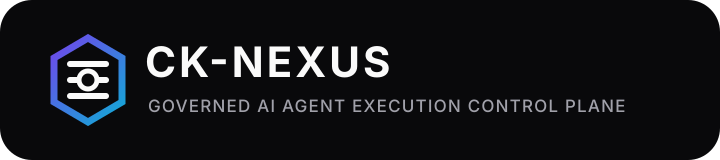

<p align="center">
  
</p>

<p align="center"><strong>Governed AI Agent Execution Control Plane</strong><br>
Policy-aware orchestration, bounded execution, verification, and evidence — built to keep autonomous systems accountable.</p>

> **Evidence-first status:** This repository contains a development candidate and implementation artifacts. Production certification, live provider authorization, recurring revenue, and independent verification are only claimed when supported by current evidence.

---

# CK-NEXUS Creator Edition

ระบบ AI แบบเมนูสำหรับครีเอเตอร์: เลือก Agent, ใส่ Creative Brief สั้น ๆ, สร้างผลงาน และเก็บประวัติไว้ใน SQLite บนเครื่องของผู้ใช้

> สถานะรุ่นนี้: **Creator Edition v0.2.0 candidate** — ใช้งานและทดสอบได้ครบใน Demo Mode, รองรับ Codex Bridge แบบ local และยังต้องมี `OPENAI_API_KEY` ที่ใช้งานได้ก่อนจึงจะยืนยัน Creator Live Mode ได้

## สิ่งที่มีในรุ่น MVP

- เว็บแอปภาษาไทย Responsive ใช้ได้บนมือถือและเดสก์ท็อป
- Minimalist Typography & Motion UI แบบไม่ใช้ icon font, emoji หรือ third-party frontend CDN
- 3 ธีม: Deep Midnight, Clean Alabaster และ Cyber Aurora พร้อมเลือกอัตโนมัติตามเวลา
- Text-based runtime status, number ticker, magnetic hover, kinetic mesh และ reduced-motion mode
- Command Palette แบบ text-only ผ่าน `Ctrl/Cmd + K`
- Creator Agents 4 ตัว
  - Content Strategist
  - Script Writer
  - Repurpose Studio
  - Editorial Reviewer
- OpenAI Agents SDK runtime พร้อม session memory แบบ SQLite
- Demo Mode สำหรับสาธิตและทดสอบโดยไม่เสียค่า API
- Local run history และ API สำหรับอ่านผลย้อนหลัง
- Copy/ดาวน์โหลดผลงานเป็น `.txt` และลบ history/memory ของ session จากหน้าเว็บ
- Optional bearer token สำหรับการเปิดใช้ผ่านเครือข่าย
- Request-size limit, rate limit, validation และ security headers
- Health/status endpoints, Dockerfile, automated tests และ release check
- Commercial license template และ seller checklist
- Optional Codex Bridge สำหรับงานวิศวกรรมซอฟต์แวร์ใน trusted local workspace
- โมดูล Billing เดิมถูกเก็บไว้เป็น optional extra และไม่อยู่ใน critical path ของรุ่นขายซอร์ส

## เริ่มใช้งานเร็วที่สุด

ต้องมี Python 3.11 ขึ้นไป

```bash
cp .env.example .env.local
python -m venv .venv
. .venv/bin/activate
python -m pip install -e ".[dev]"
python main.py
```

Windows PowerShell:

```powershell
Copy-Item .env.example .env.local
python -m venv .venv
.\.venv\Scripts\python.exe -m pip install -e ".[dev]"
.\.venv\Scripts\python.exe main.py
```

เปิด `http://127.0.0.1:8000`

หลังติดตั้ง package แล้วสามารถใช้คำสั่ง `ck-nexus` ได้โดยตรง ระบบจะอ่าน `.env.local` และเก็บ `data/` ใต้ working directory ปัจจุบัน หรือใต้ `CKNEXUS_HOME` หากตั้งค่าไว้

ไฟล์ตัวอย่างเปิด `CKNEXUS_MOCK_AI=true` เพื่อให้ผู้ซื้อทดลองระบบได้ทันทีโดยไม่ใช้ API key

## เปิด Live Mode

1. บันทึกคีย์ไว้ใน `.env.local` ภายใต้ตัวแปร `OPENAI_API_KEY`
2. เปลี่ยน `CKNEXUS_MOCK_AI=false`
3. เลือกโมเดลผ่าน `OPENAI_MODEL` (ค่าเริ่มต้น `gpt-5.6-sol`)
4. เริ่มเซิร์ฟเวอร์ใหม่

ห้ามใส่คีย์ลงใน source code, commit, screenshot หรือข้อความแชท

## คำสั่งตรวจ Release

```bash
python scripts/release_check.py
```

หรือรันแยก:

```bash
python -m compileall -q creator_app main.py
pytest -q
pip-audit
```

สร้างไฟล์ส่งมอบพร้อม SHA-256 หลัง build package:

```bash
uv build
python scripts/package_release.py
```

`pip-audit` เป็นการตรวจ dependency ที่ติดตั้งอยู่ใน environment ปัจจุบัน จึงควรรันอีกครั้งจาก clean environment ก่อนส่งมอบทุกเวอร์ชัน

## API หลัก

- `GET /health` — readiness
- `GET /api/status` — โหมดและสถานะการตั้งค่าแบบไม่เปิดเผย secret
- `GET /api/agents` — agent catalog
- `GET /api/dev-team` — รายชื่อ Development Council 5 ผู้ช่วยและสถานะ readiness
- `POST /api/dev-team/run` — ปรึกษาทีมแบบ auto/full council/focus role โดยไม่มี side effect
- `POST /api/runs` — สร้างผลงาน
- `GET /api/runs` — ประวัติ
- `GET /api/runs/{run_id}` — ผลงานรายรายการ
- `DELETE /api/sessions/{session_id}` — ลบประวัติและ memory ของ session
- `GET /docs` — OpenAPI UI
- `GET /api/codex/status` — สถานะ Codex Bridge แบบไม่เปิดเผย credential
- `POST /api/codex/tasks` — ส่งงานวิศวกรรมซอฟต์แวร์ให้ Codex (ปิดเป็นค่าเริ่มต้นและบังคับ bearer token)
- `GET /api/integrations/status` — สรุป GitHub / Slack / Google Drive / OpenAI / Database โดยไม่เปิดเผย secret
- `POST /api/integrations/test-all` — ทดสอบ integration ที่ตั้งค่าไว้จากฝั่ง server

## โครงสร้างสำคัญ

```text
creator_app/
  api.py            HTTP API, auth gate, limits, security headers
  catalog.py        Creator Agent catalog และ instructions
  runtime.py        OpenAI Agents SDK / Demo Mode
  dev_team.py       Lead Orchestrator + 5 Development Council advisers
  storage.py        Local SQLite history
  web/              หน้าเว็บแบบไม่มี third-party CDN
docs/               build brief, architecture, prompt และคู่มือผู้ขาย
tests/              API, storage, auth, rate-limit และ configuration tests
services/billing/   โมดูล SaaS เดิม (optional, ไม่เปิดใช้ใน Creator Edition)
```

## ขอบเขตที่ยังไม่ควรโฆษณาเกินจริง

- ยังไม่ใช่ Enterprise multi-node platform
- ยังไม่มี Telegram, marketplace, billing UI หรือ customer portal ในรุ่นนี้
- ยังไม่มีผล Live API smoke test จนกว่าจะตั้งค่าคีย์ที่ใช้งานได้
- License template ต้องใส่ชื่อผู้ขาย เงื่อนไข support และผ่านการตรวจทางกฎหมายก่อนใช้จริง
- หากเปิดใช้อินเทอร์เน็ตสาธารณะ ควรวางหลัง HTTPS reverse proxy และตั้ง `CKNEXUS_ACCESS_TOKEN`

อ่าน [Release Checklist](docs/RELEASE_CHECKLIST.md) ก่อนออก release จริง ส่วน Commercial License / Seller Checklist อยู่ใน seller package แยกจาก source repository เพื่อไม่ปะปนเอกสารธุรกรรมกับโค้ดส่งมอบ

รายละเอียด Integration Hub อยู่ใน [Integration Hub](docs/INTEGRATION_HUB.md), ทีมผู้ช่วยพัฒนาอยู่ใน [Development Council](docs/DEVELOPMENT_COUNCIL.md) และสถานะปัจจุบันอยู่ใน [Release Status](RELEASE_STATUS.md)

รายละเอียด UI อยู่ใน [UX Design System](docs/UX_DESIGN_SYSTEM.md), ผลตรวจอยู่ใน [Security Audit](docs/SECURITY_AUDIT.md) และ [Test Report](docs/TEST_REPORT.md)

อ่านวิธีติดตั้งและขอบเขตความปลอดภัยของ Codex ที่ [Codex Integration](docs/CODEX_INTEGRATION.md)

ติดตั้ง Codex CLI แบบ project-local ได้ด้วย `python scripts/install_codex.py`

## เอกสารอ้างอิงทางเทคนิค

Agent runtime ออกแบบตาม [OpenAI Agents SDK guide](https://developers.openai.com/api/docs/guides/agents) และใช้ `Runner.run` พร้อม local session memory ตาม [Running agents](https://developers.openai.com/api/docs/guides/agents/running-agents)

## R7 Credential Broker & Provider Router Cutover

R7 connects the R6 provider-routing primitive to the real CreatorRuntime and Development Council.
The runtime now uses a least-privilege Credential Broker, supports a loopback-only Ollama adapter,
keeps OpenAI behind brokered credentials, and exposes only redacted provider/credential status.
Gmail OAuth and GitHub App authentication are available as development-candidate integrations;
OAuth refresh tokens are ephemeral-memory only in this slice, so production still requires an
encrypted durable vault and the existing P0 staging gates. See
`docs/R7_CREDENTIAL_BROKER_PROVIDER_CUTOVER.md`.

## R9–R11 Canonical Implementation Branch

The `gateway/`, `orchestration/`, and `idea_engine/` packages implement Canonical Master Source
revision 1 sections 5–7 on top of the verified R8 baseline. R9 distributed rate limiting is
implemented with an atomic Redis Lua token bucket and does **not** silently fall back to the
process-local limiter in production. The real two-instance Redis proof remains a staging gate;
local unit tests are not production evidence.

## AGNES Execution Kernel Phase 3

Phase 3 adds a bounded autonomous development pipeline on top of the Phase 1 control plane and Phase 2
isolated sandbox. It adds real seccomp-BPF filtering, no-new-privileges/capability drop, cgroup-v2
integration hooks, distributed Redis/PostgreSQL idempotency adapters, workspace lifecycle, pipeline
state/evidence, and candidate artifacts. The pipeline always stops before merge and production deploy.
See `docs/AGNES_EXECUTION_KERNEL_PHASE3_HARDENED_PIPELINE.md`.
